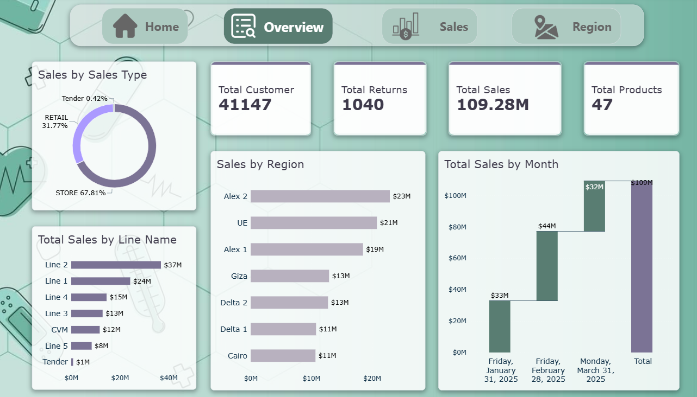
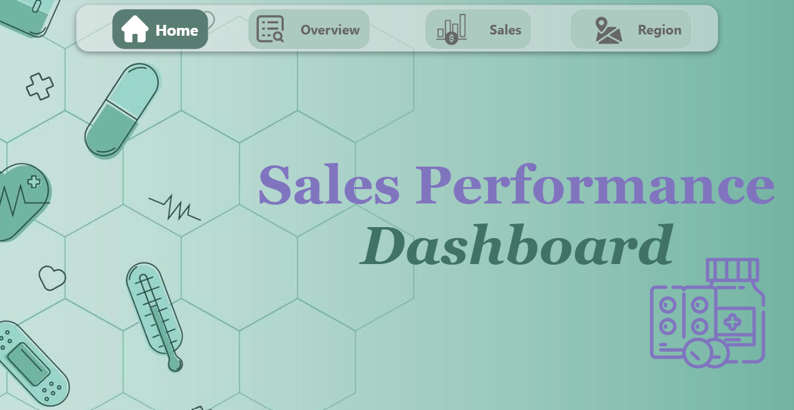
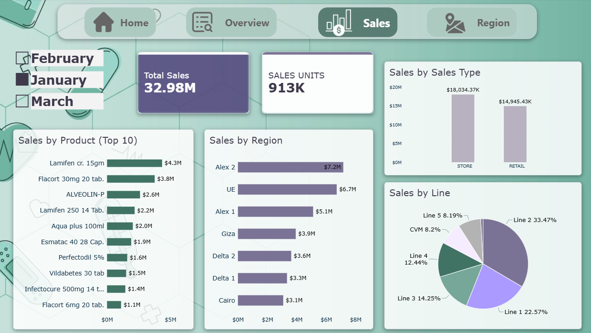
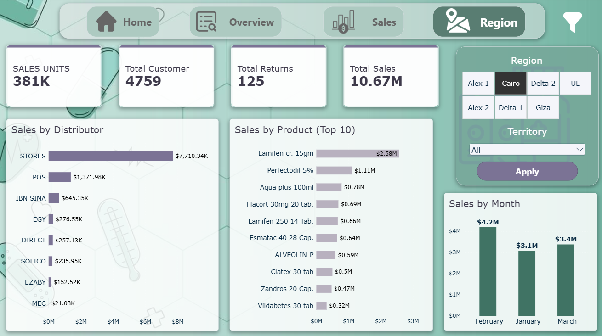

# Pharma Sales Performance Dashboard

A Power BI dashboard that analyzes pharmaceutical sales in Egypt for Q1 2025 (January to March). It helps sales managers see what is selling, where, and through which channel.



## Business Questions

The dashboard answers these questions:

1. How much did we sell in total, and how did sales change from month to month?
2. Which product lines and products bring the most revenue?
3. Which regions and territories perform best?
4. Which sales channels (Store, Retail, Tender) and distributors drive sales?

## Key Findings
 
- **Total sales were 109.28M** across 41,147 customers and 47 products.
- **February was the strongest month** at about 44M, compared with about 33M in January and 32M in March.
- **Stores are the main channel.** They make up 67.81% of sales, Retail is 31.77%, and Tender is only 0.42%.
- **Line 2 and Line 1 lead the product lines** with 37M and 24M. Together they are more than half of all sales.
- **Alex 2 is the top region** at about 23M, followed by UE at 21M and Alex 1 at 19M. Alex 2 also leads in January (7.2M).
- **Top products in January** were Lamifen cr. 15gm (4.3M), Flacort 30mg 20 tab. (3.8M), and ALVEOLIN-P (2.6M).

## Dashboard Pages

| Page | What it shows |
|---|---|
| **Home** | Landing page with navigation to all pages |
| **Overview** | Main KPIs and the full-quarter picture: sales by type, region, product line, and month |
| **Sales** | Month slicer (Jan / Feb / Mar), top 10 products, sales by region, type, and line |
| **Region** | Region and territory filters, sales by distributor, top 10 products, monthly trend |

<table>
  <tr>
    <td></td>
    <td></td>
  </tr>
  <tr>
    <td></td>
    <td></td>
  </tr>
</table>

## DAX Measures

```dax
Total Sales =
CALCULATE(
    SUM(Sales[SALES VALUE]),
    Sales[Sales State] = "Sales"
)
```

```dax
Total Returns =
CALCULATE(
    COUNT(Sales[Sales State]),
    Sales[Sales State] = "Returns"
)
```

## Dataset

Monthly sales records from January to March 2025. Each row is a sales transaction.

| Column | Description |
|---|---|
| Month | Month of the sale |
| BU | Business unit |
| DISTRIBUTOR | Distributor or channel partner |
| Territory, REGION | Sales geography |
| Line Name | Product line |
| Product Name | Product sold |
| SALES UNITS | Number of units sold |
| P Price | Price per unit |
| SALES VALUE | Units multiplied by price |
| SALES TYPE | Retail, Store, or Tender |

Customer names and codes were anonymized for privacy.

## Data Preparation

- Cleaned the raw data in Power Query (removed extra spaces, fixed data types).
- Built a data model and created DAX measures.
- Designed a four-page report with navigation buttons, slicers, and filters.

## 🛠️ Tools & Skills
 
- 📊 **Power BI**: dashboard design and interactivity (navigation, slicers, drill-down)
- 🧮 **DAX**: custom measures
- 🧹 **Power Query**: data cleaning and transformation
- 🎨 **Data Visualization** and **Data Modeling**
